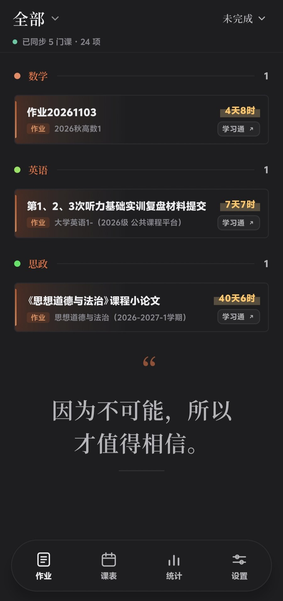
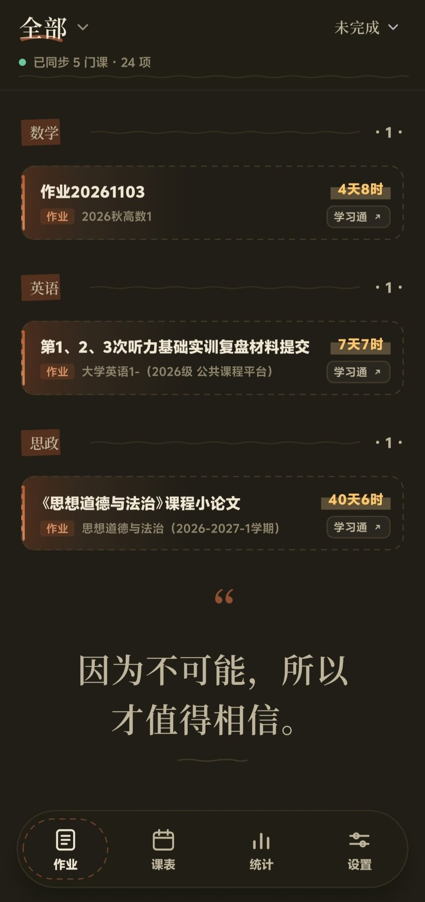

<div align="center">

# 作业板 · xuexitong-tool

把散落在几十门课程下的**作业 / 考试**，收进一个四栏看板。

按科目分组 · 截止倒计时 · 四态分类 · 全程只读 · 数据不出手机

-3DDC84?logo=android&logoColor=white)


[](https://github.com/roninVW/xuexitong-tool/releases/latest)

[下载安装](#安装) · [功能](#功能) · [自己编译](#自己编译) · [怎么工作的](#它怎么拿到数据) · [免责声明](#免责声明)

</div>

> [!WARNING]
> **非官方第三方客户端。** 读取的是学习通（超星）移动端网页的非公开接口，与超星公司无任何关系。
> 项目**只读**：不代做作业、不代交、不自动答题、不刷课。登录态只存在你自己的手机里。
> 接口随时可能因官方改版失效，不保证可用，使用风险自负。

---

## 它解决什么问题

学期中真正的麻烦不是「不知道有作业」，而是作业分散在 N 门课的 N 个入口里，而且**只有题库入口，没有一张总表**。
学习通的列表页只给「未交 / 已交」，不给截止时间（截止时间在详情页），也不给科目。

作业板做的事很窄：登录一次，把这些条目抓下来、落库、分类、排队，最后用一张按科目分组的看板呈现，让你一眼看到「今天还有什么没交」。

| | 学习通原生 | 作业板 |
|---|---|---|
| 跨课程总览 | 一科一入口，逐个点 | 一屏汇总全部课程 |
| 截止时间 | 列表页不显示，要进详情 | 每条都有倒计时（8天13时 / 2天0时 / 21时） |
| 状态 | 未交 / 已交 | 未完成 / 待批阅 / 已完成 / 已过期 四栏 |
| 科目 | 无 | 14 类关键词自动归类，可按科目筛 |
| 已批阅分数 | 分散 | 汇总进看板与统计 |

## 看一眼

实机截图（v0.40.1）。同一份数据，四种看法：深浅色 × 纸感 / 手账。

<table>
  <tr>
    <td align="center"><br><sub><b>浅色 · 纸感</b></sub></td>
    <td align="center"><br><sub><b>浅色 · 手账</b></sub></td>
    <td align="center"><br><sub><b>深色 · 纸感</b></sub></td>
    <td align="center"><br><sub><b>深色 · 手账</b></sub></td>
  </tr>
</table>

按科目分组、每条带截止倒计时（`4天8时` / `21时`）、右侧一颗「学习通」直达按钮。
界面风格在设置里一键切换；底部 Dock 的玻璃会跟着背景实时模糊。

> 更早的 HTML 设计原型在 `ui/style-a-v2.html`（可拖动模糊强度，`?blur=0..40`），截图见 `ui/preview.png`。

## 功能

**看板**
- 四态分类：未完成 / 待批阅 / 已完成 / 已过期，荧光笔徽章标记紧急度
- 按科目分组（计算机、数学、英语、思政、物理、化学、医学、经管、艺术、体育、工程、军事、通识、未分类）
- 作业与考试分开配色，考试可单独指定颜色
- 顶栏「作业 ⌄」切换作业/考试，「未完成 ⌄」打开状态 + 科目筛选（带数量）
- 点击卡片进入作业详情页（答题前一个界面），从这里点「开始答题」进入答题；不再自动跳转到答题页
- 已出分的作业 / 考试，卡片右侧直接显示分数（占原本倒计时的位置）；未出分显示剩余时间
- 右上角可一键跳学习通 App（优先尝试 App 声明的深链，失败回落应用内页面）
- 下拉刷新即同步一次
- 作业截止提醒可独立开启并设置提前时间；已完成和已过期作业不提醒，点击通知进入对应作业详情

**课表**
- 周视图，支持 CSV / TSV / ICS 导入，按周次判定当前周

**统计**
- 完成率、按科目/按状态分布；不给「时间已过去 x%」这类假进度——官方不保证给发布时间

**外观**
- 纸感令牌（浅纸 `#F6F0E2` / 深纸 `#151517`），默认唯一基色 `#C4763F`，其余颜色全部由它 HSV 派生
- 原生高斯模糊（`RenderEffect`）：各页顶部栏采样实际滚动内容，标题与操作按钮保持清晰
- 可独立切换默认材质与液态玻璃材质（Android 13+）；使用 Backdrop 官方折射，覆盖 Dock、作业页菜单、滑动条与开关
- 液态玻璃透明度与折射度独立调节、实时预览并保存；作业页子菜单使用整体单块玻璃面板
- 页面采用单水平轨道切换并保留滚动位置，支持系统减少动效；普通控件保留 Material 触摸反馈
- 背景壁纸（图片 / GIF / 视频）+ 卡片磨砂；可选卡片边缘火焰（AGSL，API 33+，低版本降级渐变）
- 手账风格可切换；深浅色跟随系统

**安全与隐私**
- 登录在 WebView 里由你自己完成，App 从不接触密码与加密算法，只收割 Cookie
- Cookie 用 Android Keystore AES-GCM 加密后存本机
- 数据全部落本地 Room / DataStore，**没有自建服务器、没有埋点、没有上传**
- 只读取当前账号自己的课程与作业，不采集同学数据

## 安装

1. 到 [Releases](https://github.com/roninVW/xuexitong-tool/releases/latest) 下载最新 `xuexitong-tool-*.apk`
   （当前版本：[v0.51.0 直接下载](https://github.com/roninVW/xuexitong-tool/releases/download/v0.51.0/xuexitong-tool-v0.51.0.apk)）
2. 允许「安装未知来源应用」后安装（自签名包，未上架任何应用商店，也不可能过审）
3. 打开 → 在登录页正常登录学习通 → 返回看板 → 下拉同步

> 顶栏出现「登录已失效」= Cookie 过期，回登录页重新登录即可。
> 安装包约 21 MB，其中 11.7 MB 是内置的 Noto Serif SC 字体（标题宋体在国产 ROM 上会退回黑体，风格会垮）。

**环境**：Android 8.0（API 26）及以上，目标 Android 16（API 36）。国内 ROM 的「性能模式」可能关掉 `RenderEffect`，此时只剩实色玻璃，功能不受影响。

> 想回看早期版本？[构建归档](https://github.com/roninVW/xuexitong-tool/releases/tag/builds) 里存着 v0.1.0 – v0.37.0 每一次迭代的包（debug 备份，不建议日常安装）。

## 自己编译

需要 JDK 21 与 Android SDK（platform 36）。工程已带 Gradle Wrapper。

```bash
cd android
./gradlew :app:assembleDebug          # 产物 app/build/outputs/apk/debug/app-debug.apk
```

Windows 上直接用仓库里的脚本（会设置好 `JAVA_HOME` / `ANDROID_HOME` 等）：

```powershell
cd android
powershell -ExecutionPolicy Bypass -File .\build.ps1
```

> 工程路径含**空格或中文**时必须强制 `-Pkotlin.compiler.execution.strategy=in-process`，否则 Kotlin 守护进程会把源码路径编码成 `u5B66u4E60…` 并报 source file not found。`build.ps1` 已包含该参数。

工具链：JDK 21.0.13 / Gradle 8.11.1 / AGP 8.9.1 / Kotlin 2.1.10 / Compose 1.7.8 / Material3 1.3.1 / Room 2.7.0 / OkHttp 4.12.0 / Jsoup 1.18.3。

## 它怎么拿到数据

学习通没有开放 API。可行路径只有一条：**复用 WebView 登录后的 Cookie，直接请求移动端 H5 页面，再用 Jsoup 解析 HTML。**


三个刻意的设计：

1. **解析器集中在一个文件**（`Parsers.kt`）。学习通改版只需要改这一处，选择器不散落在各处。
2. **详情页按需补抓**。截止时间不在列表页，逐条进详情要 20~30 次请求，所以只对「未交 / 过期且缺时间」的条目补抓，二次同步几乎零请求。
3. **不用无障碍服务、不逆向官方 App 接口**。官方 `gas/taskmsg` 校验 UA 签名且被 WAF 拦，无障碍方案随时失效且违反平台条款——这两条都已排除。

## 目录

```
.
├─ android/                    Android 工程（Kotlin + Compose）
│  └─ app/src/main/java/com/xxt/board/
│     ├─ data/                 模型 / Room / 设置 / Keystore / HTTP / 解析 / 科目分类
│     ├─ domain/SyncEngine.kt  同步编排 + 四态分类 + 状态迁移
│     └─ ui/                   看板 / 课表 / 统计 / 设置 / 登录 / WebView / 主题动效
├─ tools/probe_xxt.py         零依赖探针：用你的 Cookie 打印课程与作业（排查接口用）
├─ assets/screenshots/        实机截图（README 用）
├─ ui/style-a-v2.html         纸感设计原型（浏览器打开，可拖模糊强度）
└─ dist/                      历史构建产物（未入库，见 Release「构建归档」）
```

开发细节（模糊采样链路、M3 动效 token 表、WebView 触控的踩坑记录、逐版本变更）都在 **[android/README.md](android/README.md)**。

## 免责声明

- 本项目与**超星集团 / 学习通**无任何隶属或合作关系，未获官方授权。
- 仅用于**个人学习管理**：只能查看你自己账号下的作业与考试，不提供代做、代交、自动答题、刷课等功能，也不抓取他人数据。
- 不收集、不上传任何数据；没有服务器、没有统计埋点，全部数据留在本机。
- 软件按「现状」提供，不保证接口长期可用，不对使用造成的任何后果（含账号异常、数据丢失）承担责任。
- 请在遵守所在学校规定与学习通用户协议的前提下使用。**因使用本项目产生的一切风险由使用者自行承担。**
- 仅限学习与个人使用，请勿用于商业用途或二次分发为收费产品。

## 许可证

[MIT](LICENSE) © 2026 roninVW

第三方资源：内置字体 **Noto Serif SC** 采用 SIL Open Font License 1.1（[OFL.txt](android/app/src/main/assets/fonts/OFL.txt)），可随本项目一同分发。

## 致谢

- 思路与接口现状参考了开源项目 [siye4366/xxt-Tool](https://github.com/siye4366/xxt-Tool)（MIT）等同行的实测记录——只借鉴方向，没有复制代码。
- 视觉规范、动效 token 与踩坑记录见 [android/README.md](android/README.md)。

<div align="center"><sub>作业板 v0.40.1 · 只读 · 本地 · 无服务端</sub></div>
